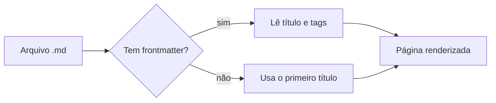
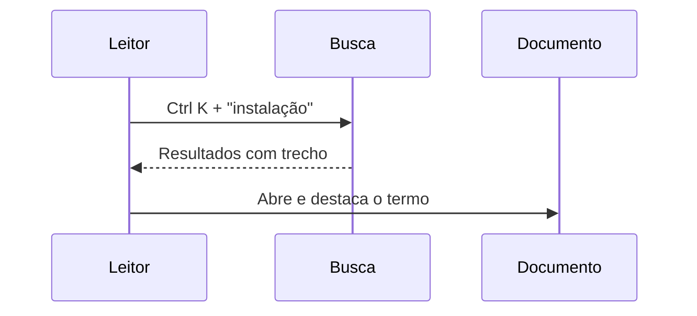

# Sintaxe Markdown

## Callouts

Duas formas equivalentes. Estilo GitHub:

> [!NOTE]
> Uma nota simples.

E estilo diretiva, com título opcional:

:::danger Operação destrutiva
Isto não pode ser desfeito.
:::

Tipos: `note`, `info`, `tip`, `success`, `important`, `warning`, `warn`, `caution`, `danger`.

## Formatação inline

| Sintaxe | Resultado |
| --- | --- |
| `==destaque==` | ==destaque== |
| `++inserido++` | ++inserido++ |
| `[[Ctrl+C]]` | [[Ctrl+C]] |
| `H~2~O` | H~2~O |
| `x^2^` | x^2^ |
| `~~riscado~~` | ~~riscado~~ |

## Código

```js
// Realce de sintaxe com botão de copiar
export const soma = (a, b) => a + b;
```

```json
{ "nome": "docfiles", "ativo": true, "versao": 1 }
```

## Diagramas

Blocos ` ```mermaid ` viram diagramas, com as cores do tema atual. O botão "Ver código" mostra o texto original.





## Fórmulas

Inline com `$...$`: a energia é $E = mc^2$ e a área do círculo é $A = \pi r^2$.
Valores como $5 e $10 não viram fórmula.

Em bloco com `$$` em linhas próprias:

$$
\int_0^1 x^2\,dx = \frac{1}{3}
$$

$$
\sum_{i=1}^{n} i = \frac{n(n+1)}{2}
$$

## Imagens

Clique em uma imagem para ampliar (Esc ou clique para fechar). O texto alternativo vira legenda.


## Listas de tarefas

- [x] Tabelas
- [x] Callouts
- [x] Diagramas

## Recolhível

<details>
<summary>Clique para expandir</summary>

Conteúdo escondido com **Markdown** dentro.

</details>

## Notas de rodapé

O índice de busca usa Fuse.js[^1].

[^1]: Biblioteca de busca fuzzy leve, sem dependências.

## Links

Links internos relativos como [instalação](./instalacao.md#build-de-produção) navegam sem recarregar; [externos](https://vite.dev) abrem em nova aba.
